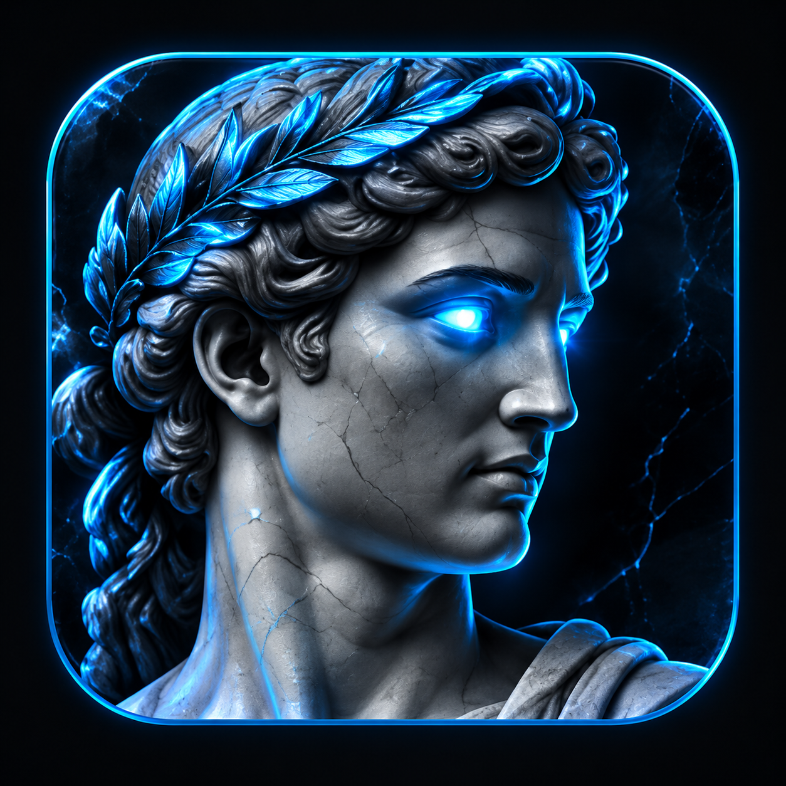
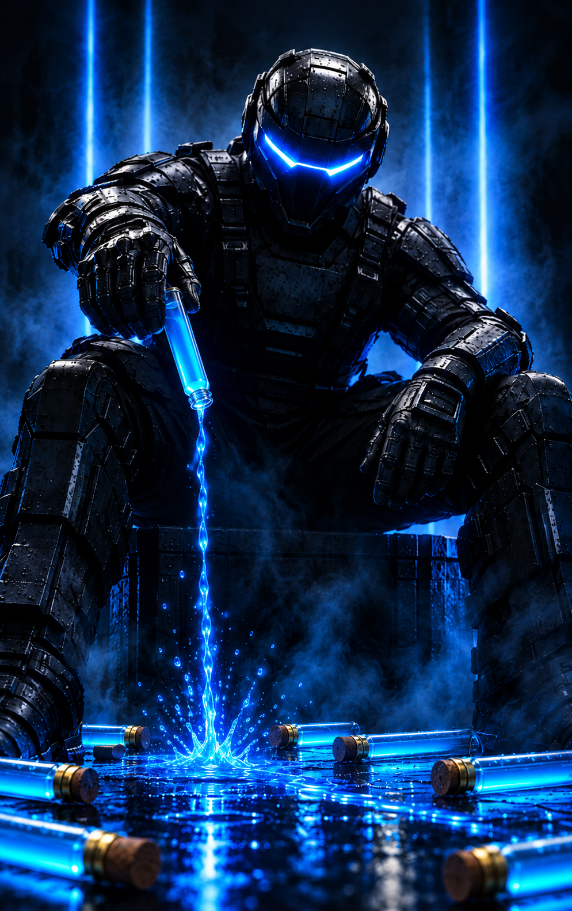

<h1>
   
  [ZXG] T7 DivinX 
  &nbsp;
</h1>

### Votre lanceur personnalisé pour Call of Duty: Black Ops III

Retrouvez vos modules, vos réglages de session et vos diagnostics dans une interface personnalisée par **STARZISMIK**.

 

 

[**Télécharger la dernière version**](https://github.com/starzismik/ZXG-T7-DivinX/releases/latest)
&nbsp;&nbsp;•&nbsp;&nbsp;
[**Site officiel**](https://www.zxg.fr)
&nbsp;&nbsp;•&nbsp;&nbsp;
[**Discord**](https://discord.gg/4cb3ENTXd4)

 

---

## Installation

Téléchargez [ZXG.T7.DivinX.1.0.2.zip](https://github.com/starzismik/ZXG-T7-DivinX/releases/download/v1.0.2/ZXG.T7.DivinX.1.0.2.zip), extrayez l'archive puis ouvrez **[ZXG] T7 DivinX.exe**.

Le lanceur, .NET, les deux modules, l'illustration et les notices sont embarqués dans un seul exécutable. Les dépendances sont extraites automatiquement au lancement. Aucun journal ni réglage personnel n'est distribué. L'exécutable n'est pas signé numériquement.

## Présentation

Le lanceur permet de choisir entre deux modules alternatifs : le menu complet et Divinium / Marché noir. Il regroupe les réglages de session, les diagnostics et les journaux.

## Fonctionnalités

- Détection et lancement de Black Ops III.
- Choix entre le menu complet et Divinium / Marché noir.
- Chargement manuel ou automatique lorsque le jeu et son rendu sont prêts.
- Réglages de session et touche d'ouverture du menu depuis l'accueil.
- Onglets Modules et Infos, diagnostics et journaux.

Les modules sont alternatifs : redémarrer le jeu pour changer de module. Toutes les options du menu n'ont pas été testées.

## Configuration

- Windows 64 bits.
- Bibliothèques Microsoft Visual C++ x64 compatibles avec les modules natifs.
- Steam et Call of Duty: Black Ops III PC.
- Un build du jeu compatible avec les modules ; une mise à jour du jeu peut nécessiter une adaptation.

## Mises à jour

Le contrôle au démarrage est connecté au manifeste public de ce dépôt. Une version supérieure bloque le lanceur ; une erreur réseau bloque également l'accès, avec possibilité de réessayer. Le téléchargement ouvre le navigateur, sans installation automatique. Pas de vérification périodique pendant une session déjà ouverte.

Compilation réussie, onze vérifications du manifeste et des versions réussies, accès réseau sans redirection et lancement de l'EXE vérifiés. Les tests ne couvrent pas toutes les fonctionnalités du jeu ni une session prolongée.

---

## Protections : intégration partielle

Cette application n'intègre pas le T7 Patch complet et ne garantit pas une protection contre tous les exploits ni contre le piratage de compte. Les tests réalisés ne constituent pas une validation exhaustive de sécurité ou de stabilité.

## Crédits

Personnalisation : **STARZISMIK**.

Bases et travaux tiers : Scroptss / Scropts-QOL, Serious, InsaneCallum, shiversoftdev et contributeurs amont. Composants comprenant notamment Dear ImGui, MinHook et Microsoft Detours. Leurs droits et attributions sont conservés ; cette page n'accorde aucune licence supplémentaire sur ces composants.

---

## Liens

---

Personnalisé par **STARZISMIK**

**[ZXG] T7 DivinX — Version 1.0.2**

© 2026 STARZISMIK — personnalisation et contributions. Droits des composants tiers conservés.

